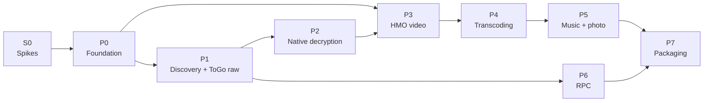

# TivoDesk

**A Go + Wails desktop app that fully replaces pyTivo: fast, MAK-based, no Java, no shared code.**

> [!NOTE]
> **Status: S0 spikes in progress on branch `tivodesk`.** Three of four spikes have results; see [S0 results](#s0-results-2026-11-10). No app code exists yet.
> Drafted 2026-10-24, reviewed and revised 2026-11-10.
> The review checked every claim below against the pyTivo source at commit `2ed403c`, the local toolchain, and current Go and Wails releases. What changed is listed in the [review log](#review-log-2026-11-10).

| | |
|---|---|
| **What** | Windows desktop app: serves video, music and photos to TiVos (HMO), downloads and decrypts recordings (ToGo), and manages the box over RPC |
| **Stack** | Go engine, Wails v2 shell (WebView2), React + TypeScript + Vite UI, SQLite, external ffmpeg |
| **Where** | New top-level folder `tivodesk/` (its own Go module) on a new branch `tivodesk` |
| **pyTivo's role** | Reference only, plus the oracle for golden tests. It stays in the repo untouched |
| **Next step** | Finish [S0](#s0-results-2026-11-10): run `tlsprobe` with the MAK, look at the tray spike, install a JRE and collect fixtures |

**Contents:** [Why](#why-replace-pytivo) · [Decisions](#decisions) · [Architecture](#architecture) · [Legacy TLS](#legacy-tls-togo) · [UI](#ui) · [Roadmap](#roadmap) · [Next steps](#next-steps) · [Risks](#risks) · [Verification](#verification) · [Review log](#review-log-2026-11-10)

---

## Why replace pyTivo

pyTivo now runs on Python 3, but its architecture is still slow. Each cost below was confirmed in the current source.

| Cost | Where | TivoDesk answer |
|---|---|---|
| Startup waits up to 30 s for the first TiVo to answer mDNS | `beacon.py` `ZCBroadcast.scan` | Continuous async browse; the app is usable immediately |
| A TiVo's first request blocks up to 5 s on a name lookup | `httpserver.py` `do_GET` → `beacon.py` `get_name` | Async, cached `get_name` |
| 503 retries loop forever, 5 s apart | `togo.py` `tivo_open` | Capped exponential backoff |
| Now Playing is paged synchronously in the request thread | `togo.py` `GetShowsList` / `NPL` | Cache keyed by `LastChangeDate`; pages streamed to the UI |
| ffmpeg probes run inline in the request thread; the cache is in-memory only (1,000 entries) and is lost on restart | `transcode.py` `video_info` | Persistent SQLite index filled by a background ffprobe pool |
| TS sync bytes are checked packet by packet in Python, with an optional sleep per chunk | `togo.py` `get_tivo_file` | Native validation inside the streaming decrypt pipeline |
| Stream decryption shells out to `tivolibre.exe`, which needs a Java runtime | `transcode.py` `transcode` | Native Go Turing, PS and TS decoders |

## Decisions

### Settled

- **Go + Wails v2** desktop app (WebView2), with a React + TS + Vite UI.
- **Native `.TiVo` decryption (PS and TS) from day one.** No Java or tivolibre at runtime.
- **TiVo RPC (port 1413) in v1:** rich recording list, delete, To Do, season passes, remote keys. The client certificate is supplied by the user, not embedded.
- **ffmpeg and ffprobe stay external binaries**, bundled for transcoding.
- **Windows first.** Secrets, service mode, sleep prevention and the installer are Windows-specific. Nothing in the engine should rule out other platforms later.
- **Dropped:** the web admin pages and the `settings`, `togo`, `desktop` and `vrd` plugins. The desktop UI replaces them.

### Open

These came out of the review. Each has a recommendation; none blocks the S0 spikes.

| Question | Why it matters | Recommendation |
|---|---|---|
| ~~Wails v2 or v3?~~ | **Settled by S0-3:** the tray spike works on v2, which was the only reason to consider v3 (still in beta). | Wails v2. Keep `app.go` thin so a later move is cheap. |
| ~~Go toolchain version~~ | **Settled by S0-1:** Go 1.27.3 talks to both TiVos. | Go 1.27, pinned with a `toolchain` line. |
| **TSN classes for newer boxes** | One of the two LAN TiVos is an Edge (`tcd/Keystone`, TSN prefix `D6E`). pyTivo's `is4Ktivo` only knows `849` and `8F9`, so it treats the Edge as plain HD. | Classify from the mDNS `platform` property as well as the TSN prefix. Keep pyTivo's behaviour for golden parity, and add the new classes on top. |
| **Is service mode in v1?** | A Windows service runs in session 0 as a different account. It cannot show the WebView2 UI and cannot read the user's Credential Manager, where the plan stores the MAK. Service mode therefore needs a UI-to-engine IPC layer and a second secret store. | Defer service mode past v1. Ship tray + start-at-login instead. Define the engine API as a Go interface now so IPC can be added without rewriting the UI. |
| **Access control on the HMO server** | pyTivo has `allowed_clients` and per-TSN checks (`httpserver.py` `authorize`). The plan never mentioned them. | Port the same rule: open by default, restricted when `allowed_clients` is set. |

## Architecture

All logic lives in a headless engine (`internal/core`). The Wails `app.go` is a thin layer of bindings plus an event bridge. `cmd/tivodesk-cli` runs the same engine for tests and debugging tools (`decrypt`, `npl`, `rpc`, `tlsprobe`, `golden`).

### Packages

| Package | Responsibility | pyTivo reference |
|---|---|---|
| `config` (+ `pytivoimport`) | TOML config; lookup order `_tivo_<TSN>` → SD/HD/4K class → Server; TSN classification; strtod and bitrate helpers; INI importer with cp1252 fallback | `config.py`: `get_tsn`, `isHDtivo`, `is4Ktivo`, `is_ts_capable`, `strtod`; `plugins/settings/help.txt` |
| `secrets` | MAK and cert password in Windows Credential Manager (go-keyring) | — |
| `discovery` | Continuous async mDNS browse of `_tivo-videos`; advertise shares; UDP/TCP 2190 beacon; async cached `get_name` | `beacon.py` |
| `tivo` / `netutil` | TiVo registry (TSN, IP, TXT properties); interface selection (skip Hyper-V, WSL, VPN); per-subnet broadcast | `httpserver.py` `do_GET`; `config.py` `get_ip` |
| `hmo` (`video`, `music`, `photo`) | `net/http` TiVoConnect server: QueryContainer/Item/Formats/Server, TVBusQuery, paging, anchors, sort, recurse, Range/206, synthetic TiVo header, `allowed_clients`; `text/template` XML parsed once | `httpserver.py`; `plugin.py` `item_count`; `plugins/video/video.py`; `plugins/video/templates/*`; `templates/root_container.tmpl`; `plugins/music`; `plugins/photo` |
| `library` | SQLite index (modernc.org/sqlite), fsnotify watcher, ffprobe worker pool, so browsing never probes inline | — |
| `media/{probe,transcode,meta,image}` | ffprobe JSON normalized to pyTivo's `vInfo`; compatibility rules and ffmpeg argument builder; ring buffer for resume; metadata formats (.txt, .nfo, MP4, WTV) | `plugins/video/transcode.py`; `metadata.py` |
| `tivocrypt/{turing,tivofile,ps,ts}` | Native Turing cipher; header and metadata decrypt; PS and TS stream decoders as streaming `io.Reader`s | `turing.py`; `metadata.py` `_tdcat_py`, `from_tivo`; algorithm from tivolibre (BSD-2) and tivodecode |
| `togo` | Per-TiVo `http.Client`: legacy TLS, Digest/Basic (`tivo`/MAK), `sid` cookie, TSN header; NPL cached by `LastChangeDate`, pages streamed to the UI; capped exponential backoff on 503 | `plugins/togo/togo.py`: `tivo_ssl_context`, `tivo_open`, `GetShowsList`, `get_out_file`, `get_tivo_file` |
| `jobs` | Download queue persisted in SQLite; one worker per TiVo; pipeline download → decrypt → TS validation → write → `.txt` details → post-process hook; prevent sleep | `togo.py`: `ToGo`, `process_queue`, `get_tivo_file`, `post_process_file` |
| `rpc` | MRPC/2 client over TLS with a client cert (.p12 via go-pkcs12, or PEM); request multiplexing by RpcId; keepalive and reconnect | kmttg `rpc/Remote.java` (external) |
| `events`, `logx`, `power` | Pub/sub to the UI (progress throttled to about 4 Hz); slog plus a ring buffer for the log viewer, with the MAK masked; `SetThreadExecutionState` | — |

References are by function name rather than line number, because line numbers drift as pyTivo is maintained.

### Key libraries

| Area | Library |
|---|---|
| mDNS | `brutella/dnssd` |
| Digest auth | `icholy/digest`, or a small in-house implementation |
| Config and import | `go-toml/v2`, `ini.v1` |
| Folder watching | `fsnotify` |
| Caches | `golang-lru/v2` |
| Music tags | `dhowden/tag` |
| Photos | `x/image`, `goexif` |
| Rate limiting | `x/time/rate` |
| Tray | `energye/systray` (to be proven in spike S0-3) |
| Frontend | Zustand, TanStack Table + Virtual |

## Legacy TLS (ToGo)

Older TiVos only speak TLS configurations that modern stacks reject by default. pyTivo handles this with `SECLEVEL=0` in `tivo_ssl_context`. The Go equivalent:

- `InsecureSkipVerify: true` (TiVos use self-signed certificates; access is still protected by the MAK).
- An explicit `CipherSuites` list that includes the RSA key-exchange suites. This is the one setting that matters.
- `MinVersion: tls.VersionTLS10`, to cover older boxes than the two tested.
- No `godebug` lines.

> [!IMPORTANT]
> **Confirmed by S0-1 on Go 1.27.3.** Go's default configuration fails the handshake on both TiVos, because they only offer RSA key exchange. With an explicit cipher list both negotiate TLS 1.2 with `TLS_RSA_WITH_AES_128_GCM_SHA256`, and no GODEBUG setting is needed. Neither box needs 3DES, TLS 1.0 or `tlssha1`.
>
> The original recipe relied on `tlsrsakex=1` and `tls3des=1`, which Go 1.27 removed. It also mixed two syntaxes: `//go:debug` belongs in a `main` package source file, while `go.mod` uses a plain `godebug` line.

**Plain HTTP is not a fallback.** Port 80 on both boxes answers Now Playing requests with 403. If a future Go release drops RSA key exchange altogether, the options are a vendored legacy TLS client used only for the ToGo connection, or pinning the toolchain.

## UI

| Page | Contents |
|---|---|
| **Dashboard** | Health, ports, TiVos online, active transfers, warnings |
| **TiVos** | Discovered boxes and their properties |
| **Now Playing** | Virtualized list grouped by series; download and delete; details drawer |
| **Transfers** | ToGo queue plus serving-to-TiVo activity |
| **To Do** | Upcoming recordings (RPC) |
| **Season Passes** | View and manage (RPC) |
| **Remote** | Key events (RPC) |
| **Shares** | Video, music and photo folders |
| **Settings** | Includes first-run MAK entry, the `pyTivo.conf` import wizard and the RPC cert |
| **Logs** | Live viewer, MAK masked |

## Roadmap

Every phase ends with a demo and green CI: `go test ./...`, golangci-lint, `npm run build`, and `wails build` on windows-latest. The repo has no CI today, so P0 creates the workflow.

| Phase | What gets built | Done when |
|---|---|---|
| **S0 Spikes** *(new)* | Toolchain install; `tlsprobe`; fixture collection with the existing pyTivo; Turing port; tray and single-instance spike | See [Next steps](#next-steps) |
| **P0 Foundation** | Wails init, engine lifecycle, event bus, logging, config/TOML + importer, secrets, single instance, CI workflow | Importer round-trips `pyTivo.conf.dist` and a set of committed INI fixtures (per-TiVo sections, cp1252, `%` in values); settings editable in the UI; MAK entered and stored; `tests/test_config.py` cases ported |
| **P1 Discovery + ToGo raw** | mDNS browse, togo client, NPL cache, jobs queue, raw PS/TS `.TiVo` download, naming, `.txt` details | 1,000+ recordings listed in seconds (instant with a warm cache); PS and TS downloads complete; queue survives a restart |
| **P2 Native decryption** | turing → tivofile/metadata → PS → TS; streaming decrypt during download; `tivodesk-cli decrypt` | SHA-256 of output equals tivolibre's output for every fixture; decrypt throughput at least 4× the fastest observed TiVo download rate |
| **P3 HMO video, no transcoding** | hmo server, library index, video container, TVBus, paging, `send_file` with Range, `.TiVo` passthrough plus decrypt-on-serve, mDNS advertising, beacon | Share appears on the TiVo with the correct icon; 5k-file browse is instant; MPEG-2 plays and resumes; golden XML matches pyTivo |
| **P4 Transcoding** | Probe normalization, compatibility rules, ffmpeg argument builder, chunked streaming, resume ring buffer, `.TiVo` → native decrypt → ffmpeg | MKV/MP4 plays on SD (PS) and on Roamio/Bolt (TS copy); golden ffmpeg arguments match pyTivo |
| **P5 Music + photo** | Playlists, shuffle, seek; scale, rotate, EXIF | Plays and displays correctly on a TiVo |
| **P6 RPC** *(parallel track after P1)* | MRPC framing, auth, session; recordings, delete, To Do, season passes, keyEventSend; capability detection | All operations work against a real TiVo and the fake MRPC server; unsupported TiVos degrade gracefully |
| **P7 Packaging** | NSIS installer with firewall rules (TCP 9032, TCP/UDP 2190, UDP 5353), start at login, bundled ffmpeg, detection of a running pyTivo and port conflicts, pprof pass, signing | Clean install on Windows 11; performance targets met |

**Performance targets:** container browse under 50 ms server time for 5k entries; warm NPL under 200 ms; cold start to advertising under 1 s.

## Next steps

The S0 spikes are small, independent, and throwaway-friendly. Together they answer the questions most likely to change the plan, before any app code exists.

**Prerequisites.** This machine currently has Node 26 but no Go, no Wails CLI and no Java.

- [ ] Install Go 1.27 and the Wails v2 CLI; run `wails doctor`.
- [ ] Put a JRE in `bin\jre\`. `bin\tivolibre.exe` is a wrapped JAR and will not run without one. This is a development-time oracle only; it does not affect the "no Java at runtime" decision.

**Spikes.**

| # | Spike | Answers | Done when |
|---|---|---|---|
| **S0-1** | `tlsprobe`: a single-file Go program that connects to each TiVo on 443 with the explicit legacy config, then fetches one NPL page with digest auth | Does Go 1.27 still talk to these TiVos? Is `tlssha1` needed? | A table per TiVo: negotiated version, cipher suite, whether NPL returned 200 |
| **S0-2** | Collect fixtures with the **existing pyTivo ToGo**: at least one PS and one TS raw `.TiVo` per box, short recordings, plus tivolibre output and SHA-256 for each. Stored outside the repo under `TIVODESK_FIXTURES` | Removes P2's dependency on P1. Confirms the oracle works. | Fixture folder with a manifest of hashes |
| **S0-3** | Wails v2 hello-world with `energye/systray`, single instance, close-to-tray | Is v2 + a third-party tray good enough, or does this push toward v3? | Tray icon, menu, restore and single-instance all work on Windows 11 |
| **S0-4** | Port `turing.py` to Go; port the four `tests/test_turing.py` cases; decrypt the metadata chunk of a real fixture; benchmark | First proof that native decryption is tractable. Sets a real throughput number. | Tests pass; Go output matches `_tdcat_py` on a fixture; MB/s recorded |

**Then:** settle the [open decisions](#open) and start P0.

### S0 results (2026-11-10)

Toolchain installed: Go 1.27.3 and Wails CLI v2.17.1 (`wails doctor` passes). No JRE yet.

| Spike | Status | Result |
|---|---|---|
| **S0-1** `tlsprobe` | **Done** | Both TiVos connect with an explicit cipher list: TLS 1.2, `TLS_RSA_WITH_AES_128_GCM_SHA256`. Go defaults fail. Now Playing over HTTPS with digest auth returns 200 on both (684 and 584 recordings). Certificates are RSA-2048, SHA-1 signed, valid to 2030 and 2035. Port 80 returns 403. |
| **S0-2** Fixtures | Not started | Needs the MAK and a JRE in `bin\jre\`. |
| **S0-3** Tray | **Done** | `energye/systray` v1.0.3 works with Wails v2.17.1: tray icon, menu, close-to-tray and restore confirmed by eye. Single instance verified: a second launch exits and one process remains. 12 MB exe, 69 MB working set. Wails v2 stays. |
| **S0-4** Turing | Done, except for a real fixture | Go keystream matches `turing.py` byte for byte across four key and IV sizes and eight skip offsets. The metadata decrypt matches `_tdcat_py` on a synthetic header. 371 MB/s; 11 µs per key setup (Ryzen 5 7640U, one core). |

The two TiVos found by mDNS:

| Name | Platform | TSN prefix | Software |
|---|---|---|---|
| Family Room | `tcd/Keystone` (Edge) | `D6E` | 21.11.1 |
| Paella Tivo | `tcd/Series5` (Roamio) | `846` | 20.7.4d |

**To finish S0:**

- [x] Run `tlsprobe` with the MAK (it reads `TIVO_MAK` from the environment and never prints it).
- [x] Run `tivodesk\spikes\tray\build\bin\tray.exe` and check the tray icon, its menu, close-to-tray and restore.
- [ ] Install a JRE, then collect PS and TS fixtures with pyTivo (S0-2).
- [ ] Run the Go metadata decrypt against a real fixture.

**Where the code is:**

| Path | What |
|---|---|
| `tivodesk/internal/tivocrypt/turing` | Turing cipher, tests, benchmarks. Written to be kept. |
| `tivodesk/internal/tivocrypt/tivofile` | `.TiVo` header parser and metadata decrypt. Written to be kept. |
| `tivodesk/cmd/tlsprobe` | The TLS probe. |
| `tivodesk/tools/gen_turing.py` | Generates the Go tables and the test vectors from pyTivo. |
| `tivodesk/spikes/tray` | Wails tray spike. Throwaway, with its own Go module. |

## Risks

| # | Risk | Mitigation |
|---|---|---|
| 1 | **TS decryption is the hardest piece.** The private TiVo PID (stream_type 0x97) carries per-stream key blocks, PES headers can be split across packets, and key packets can arrive late, so scrambled packets must be buffered. | Build PS first; port tivolibre's structure; gate on byte-for-byte equality; fuzz the parsers; resync on 0x47. Fixtures arrive early via S0-2. |
| 2 | **Legacy TLS.** Retired for the two LAN TiVos by S0-1. It remains a risk for older boxes, and for future Go releases that could remove RSA key exchange. | Explicit cipher config; keep `tlsprobe` as a CLI tool and run it after every Go upgrade. |
| 3 | **RPC client cert.** The user supplies it, and the widely used certificate has expired and been reissued before. | RPC sits behind a feature flag and is optional for the rest of the app. Show the cert's expiry date in Settings and warn ahead of it. |
| 4 | **The decryption oracle needs Java.** `tivolibre.exe` will not run without a JRE, and `bin\` has no `tivodecode`. | Install a JRE for development; record oracle hashes in the fixture manifest so most test runs don't need Java at all. |
| 5 | **Coexistence with a running pyTivo.** Ports 9032 and 2190 may be taken. | Detect and show a banner. Use a distinct, persistent GUID (pyTivo generates a new `uuid4` on every start). |
| 6 | **Multi-homed Windows and the firewall.** | Interface-selection setting; installer adds firewall rules; Dashboard offers a fix. |
| 7 | **Probe drift.** ffprobe JSON and pyTivo's `ffmpeg -i` text parsing can disagree, which changes compatibility decisions. | Golden tests over a media matrix. |
| 8 | **Service mode vs. secrets and UI.** See [open decisions](#open). | Deferred past v1; engine API defined as an interface. |
| 9 | **Licensing.** | Turing/Qualcomm attribution in the About page; ship ffmpeg's license notices. |

## Verification

**Unit tests**
- Port `tests/test_turing.py`, `test_config.py` and `test_metadata.py`.
- Add tests for naming, NPL parsing, digest auth (`httptest`), MRPC framing and paging rules.
- Fuzz the PS, TS, header, MRPC and Range parsers.

**Golden parity with pyTivo**
- A harness in `tivodesk/tools/golden/` reuses the `tests/test_server.py` fixtures to run pyTivo on lavfi-generated media.
- pyTivo's GUID is a module-level `uuid4`, so the harness must pin it (patch `config.guid`) for stable output.
- It records the XML for a matrix of commands × TSN classes:

  | Class | TSN prefix | Why |
  |---|---|---|
  | SD | `540` | PS only |
  | SD edge case | `649` | Starts with 6 but is excluded from HD by `isHDtivo` |
  | HD, PS only | `648` | HD without TS |
  | HD + TS | `663`, `746` | `663` is TS-capable by special case |
  | 4K | `849`, `8F9` | Both prefixes are in `is4Ktivo` |

- It also records the `transcode()` arguments and `tivo_compatible()` result as JSON, and the `tivo_header()` bytes.
- The Go tests compare canonicalized output against these files.

**Decryption golden**
- Real `.TiVo` fixtures live outside the repo, pointed to by `TIVODESK_FIXTURES`.
- Output is compared with tivolibre (streams) and `tdcat` (metadata) hashes from the manifest.
- Tests skip when fixtures are absent. Benchmarks cover Turing, PS and TS.

**Fakes**
- A fake TiVo: TLS, digest, `sid` cookie, NPL pages, injected 503s, downloads.
- A fake MRPC server that requires a client cert.
- Loopback mDNS and beacon.

**Manual end-to-end against the two LAN TiVos, per release candidate**
- [ ] Discovery within 5 s
- [ ] Browse and paging; jump by letter
- [ ] Playback and resume; stop kills ffmpeg
- [ ] Transcode on SD, HD and 4K
- [ ] Music and photos
- [ ] ToGo PS and TS, raw and decrypted, compared with tivolibre; NPL refresh time vs pyTivo
- [ ] The download queue survives a restart
- [ ] RPC: delete, To Do, season passes, remote latency under 150 ms
- [ ] Port-conflict banner; MAK masked in logs

---

## Review log (2026-11-10)

What the review found and what changed in this document.

| Finding | Change |
|---|---|
| Go 1.27 removed `tlsrsakex` and `tls3des`; the original line also mixed `//go:debug` and `go.mod` syntax | Legacy TLS section rewritten around explicit config; Go target raised to 1.27; `tlsprobe` moved to the front as S0-1 |
| Go, Wails and Java are not installed on this machine; `tivolibre.exe` needs a JRE | Added prerequisites and risk 4 |
| P2 waited on P1 for fixtures, but pyTivo's ToGo can collect them today | Added S0-2; removed "collect fixtures" from P1's exit criteria |
| The local `pyTivo.conf` is gitignored and holds only a port, an ffmpeg path and one share (no MAK) | P0's exit criterion now uses `pyTivo.conf.dist` and committed fixtures; first-run MAK entry added to Settings |
| The repo has no CI | P0 now creates the workflow |
| "ffmpeg probe on every request" was overstated: `video_info` has an in-memory LRU | Reworded in the cost table |
| "Turing at least 500 MB/s" was an arbitrary figure; downloads from a TiVo are far slower than that | P2's criterion is now relative to the measured download rate; S0-4 records the real number |
| The 4K class also includes prefix `8F9`; `649` is a special case | Golden matrix extended |
| Service mode conflicts with Credential Manager and WebView2 | Moved to open decisions; `winsvc` dropped from the v1 package list |
| pyTivo's `allowed_clients` check was missing | Added to `hmo` and to open decisions |
| Wails v3 reached beta in August 2026 | Recorded as an open decision; recommendation is to stay on v2 |
| The 14 `file:line` references checked were accurate, but will drift | Replaced with function names |

Not verified by this review: the RPC protocol details taken from kmttg. The TLS question it left open was settled the same day by S0-1.
