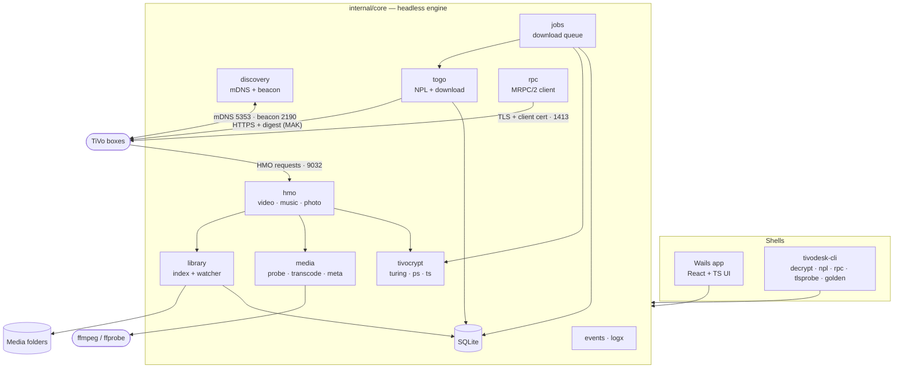
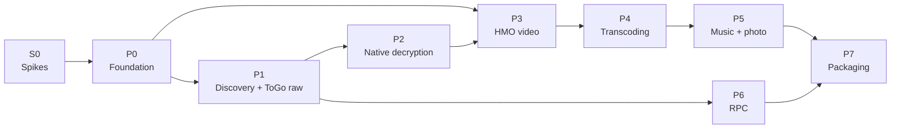

# TivoDesk

**A Go + Wails desktop app that fully replaces pyTivo: fast, MAK-based, no Java, no shared code.**

> [!NOTE]
> **Status: P1 is done on branch `tivodesk`.** The app finds TiVos, lists their recordings and downloads them, still encrypted, and all three are confirmed on both real TiVos; see [P1 progress](#p1-progress-2026-11-11). P2, native decryption, is written and decrypts both real transport-stream recordings correctly with the real key; program streams and decrypting during a download from a real TiVo are still untested; see [P2 progress](#p2-progress-2026-11-11).
> Drafted 2026-10-24, reviewed and revised 2026-11-10.
> The review checked every claim below against the pyTivo source at commit `2ed403c`, the local toolchain, and current Go and Wails releases. What changed is listed in the [review log](#review-log-2026-11-10).

| | |
|---|---|
| **What** | Windows desktop app: serves video, music and photos to TiVos (HMO), downloads and decrypts recordings (ToGo), and manages the box over RPC |
| **Stack** | Go engine, Wails v2 shell (WebView2), React + TypeScript + Vite UI, SQLite, external ffmpeg |
| **Where** | New top-level folder `tivodesk/` (its own Go module) on a new branch `tivodesk` |
| **pyTivo's role** | Reference only, plus the oracle for golden tests. It stays in the repo untouched |
| **Next step** | Download a recording from a real TiVo with "Decrypt recordings as they download" on, and check the result with ffmpeg. Then find a program-stream recording to test, since none has been decrypted yet |

**Contents:** [Why](#why-replace-pytivo) · [Decisions](#decisions) · [Architecture](#architecture) · [Legacy TLS](#legacy-tls-togo) · [UI](#ui) · [Roadmap](#roadmap) · [Next steps](#next-steps) · [Risks](#risks) · [Verification](#verification) · [Review log](#review-log-2026-11-10)

---

## Why replace pyTivo

pyTivo now runs on Python 3, but its architecture is still slow. Each cost below was confirmed in the current source.

| Cost | Where | TivoDesk answer |
|---|---|---|
| Startup waits up to 30 s for the first TiVo to answer mDNS | `beacon.py` `ZCBroadcast.scan` | Continuous async browse; the app is usable immediately |
| A TiVo's first request blocks up to 5 s on a name lookup | `httpserver.py` `do_GET` → `beacon.py` `get_name` | Async, cached `get_name` |
| 503 retries loop forever, 5 s apart | `togo.py` `tivo_open` | Capped exponential backoff |
| Now Playing is paged synchronously in the request thread | `togo.py` `GetShowsList` / `NPL` | Cache keyed by `LastChangeDate`; the list saved between runs |
| ffmpeg probes run inline in the request thread; the cache is in-memory only (1,000 entries) and is lost on restart | `transcode.py` `video_info` | Persistent SQLite index filled by a background ffprobe pool |
| TS sync bytes are checked packet by packet in Python, with an optional sleep per chunk | `togo.py` `get_tivo_file` | Native validation inside the streaming decrypt pipeline |
| Stream decryption shells out to `tivolibre.exe`, which needs a Java runtime | `transcode.py` `transcode` | Native Go Turing, PS and TS decoders |

## Decisions

### Settled

- **Go + Wails v2** desktop app (WebView2), with a React + TS + Vite UI.
- **Native `.TiVo` decryption (PS and TS) from day one.** No Java or tivolibre at runtime.
- **TiVo RPC (port 1413) in v1:** rich recording list, delete, To Do, season passes, remote keys. The client certificate is supplied by the user, not embedded.
- **ffmpeg and ffprobe stay external binaries**, bundled for transcoding.
- **Windows first.** Secrets, service mode, sleep prevention and the installer are Windows-specific. Nothing in the engine should rule out other platforms later.
- **Dropped:** the web admin pages and the `settings`, `togo`, `desktop` and `vrd` plugins. The desktop UI replaces them.

### Open

These came out of the review. Each has a recommendation; none blocks the S0 spikes.

| Question | Why it matters | Recommendation |
|---|---|---|
| ~~Wails v2 or v3?~~ | **Settled by S0-3:** the tray spike works on v2, which was the only reason to consider v3 (still in beta). | Wails v2. Keep `app.go` thin so a later move is cheap. |
| ~~Go toolchain version~~ | **Settled by S0-1:** Go 1.27.3 talks to both TiVos. | Go 1.27, pinned with a `toolchain` line. |
| **TSN classes for newer boxes** | One of the two LAN TiVos is an Edge (`tcd/Keystone`, TSN prefix `D6E`). pyTivo's `is4Ktivo` only knows `849` and `8F9`, so it treats the Edge as plain HD. | Classify from the mDNS `platform` property as well as the TSN prefix. Keep pyTivo's behaviour for golden parity, and add the new classes on top. |
| **Is service mode in v1?** | A Windows service runs in session 0 as a different account. It cannot show the WebView2 UI and cannot read the user's Credential Manager, where the plan stores the MAK. Service mode therefore needs a UI-to-engine IPC layer and a second secret store. | Defer service mode past v1. Ship tray + start-at-login instead. Define the engine API as a Go interface now so IPC can be added without rewriting the UI. |
| ~~Access control on the HMO server~~ | **Settled:** pyTivo's rule is ported in `config` (open by default, restricted when `allowedips` is set). | The HMO server enforces it in P3. |

## Architecture

All logic lives in a headless engine (`internal/core`). The Wails `app.go` is a thin layer of bindings plus an event bridge. `cmd/tivodesk-cli` runs the same engine for tests and debugging tools (`decrypt`, `npl`, `rpc`, `tlsprobe`, `golden`).



### Packages

| Package | Responsibility | pyTivo reference |
|---|---|---|
| `config` (+ `pytivoimport`) | TOML config; lookup order `_tivo_<TSN>` → SD/HD/4K class → Server; TSN classification; strtod and bitrate helpers; INI importer with cp1252 fallback | `config.py`: `get_tsn`, `isHDtivo`, `is4Ktivo`, `is_ts_capable`, `strtod`; `plugins/settings/help.txt` |
| `secrets` | MAK and cert password in Windows Credential Manager (go-keyring) | — |
| `discovery` | Continuous async mDNS browse of `_tivo-videos`; advertise shares; UDP/TCP 2190 beacon; async cached `get_name` | `beacon.py` |
| `tivo` / `netutil` | TiVo registry (TSN, IP, TXT properties); interface selection (skip Hyper-V, WSL, VPN); per-subnet broadcast | `httpserver.py` `do_GET`; `config.py` `get_ip` |
| `hmo` (`video`, `music`, `photo`) | `net/http` TiVoConnect server: QueryContainer/Item/Formats/Server, TVBusQuery, paging, anchors, sort, recurse, Range/206, synthetic TiVo header, `allowed_clients`; `text/template` XML parsed once | `httpserver.py`; `plugin.py` `item_count`; `plugins/video/video.py`; `plugins/video/templates/*`; `templates/root_container.tmpl`; `plugins/music`; `plugins/photo` |
| `library` | SQLite index (modernc.org/sqlite), fsnotify watcher, ffprobe worker pool, so browsing never probes inline | — |
| `media/{probe,transcode,meta,image}` | ffprobe JSON normalized to pyTivo's `vInfo`; compatibility rules and ffmpeg argument builder; ring buffer for resume; metadata formats (.txt, .nfo, MP4, WTV) | `plugins/video/transcode.py`; `metadata.py` |
| `tivocrypt/{turing,tivofile,ps,ts}` | Native Turing cipher; header and metadata decrypt; PS and TS stream decoders as streaming `io.Reader`s | `turing.py`; `metadata.py` `_tdcat_py`, `from_tivo`; algorithm from tivolibre (BSD-2) and tivodecode |
| `togo` | Per-TiVo `http.Client`: legacy TLS, Digest/Basic (`tivo`/MAK), `sid` cookie, TSN header; NPL cached by `LastChangeDate`, the list saved between runs; capped exponential backoff on 503 | `plugins/togo/togo.py`: `tivo_ssl_context`, `tivo_open`, `GetShowsList`, `get_out_file`, `get_tivo_file` |
| `jobs` | Download queue persisted in SQLite; one worker per TiVo; pipeline download → decrypt → TS validation → write → `.txt` details → post-process hook; prevent sleep | `togo.py`: `ToGo`, `process_queue`, `get_tivo_file`, `post_process_file` |
| `rpc` | MRPC/2 client over TLS with a client cert (.p12 via go-pkcs12, or PEM); request multiplexing by RpcId; keepalive and reconnect | kmttg `rpc/Remote.java` (external) |
| `events`, `logx`, `power` | Pub/sub to the UI (progress throttled to about 4 Hz); slog plus a ring buffer for the log viewer, with the MAK masked; `SetThreadExecutionState` | — |

References are by function name rather than line number, because line numbers drift as pyTivo is maintained.

### Key libraries

| Area | Library |
|---|---|
| mDNS | `libp2p/zeroconf/v2` (`brutella/dnssd` finds nothing on this PC; see P1 progress) |
| Digest auth | `icholy/digest`, or a small in-house implementation |
| Config and import | `go-toml/v2`, `ini.v1` |
| Folder watching | `fsnotify` |
| Caches | `golang-lru/v2` |
| Music tags | `dhowden/tag` |
| Photos | `x/image`, `goexif` |
| Rate limiting | `x/time/rate` |
| Tray | `energye/systray` (to be proven in spike S0-3) |
| Frontend | Zustand, TanStack Table + Virtual |

## Legacy TLS (ToGo)

Older TiVos only speak TLS configurations that modern stacks reject by default. pyTivo handles this with `SECLEVEL=0` in `tivo_ssl_context`. The Go equivalent:

- `InsecureSkipVerify: true` (TiVos use self-signed certificates; access is still protected by the MAK).
- An explicit `CipherSuites` list that includes the RSA key-exchange suites. This is the one setting that matters.
- `MinVersion: tls.VersionTLS10`, to cover older boxes than the two tested.
- No `godebug` lines.

> [!IMPORTANT]
> **Confirmed by S0-1 on Go 1.27.3.** Go's default configuration fails the handshake on both TiVos, because they only offer RSA key exchange. With an explicit cipher list both negotiate TLS 1.2 with `TLS_RSA_WITH_AES_128_GCM_SHA256`, and no GODEBUG setting is needed. Neither box needs 3DES, TLS 1.0 or `tlssha1`.
>
> The original recipe relied on `tlsrsakex=1` and `tls3des=1`, which Go 1.27 removed. It also mixed two syntaxes: `//go:debug` belongs in a `main` package source file, while `go.mod` uses a plain `godebug` line.

**Plain HTTP is not a fallback.** Port 80 on both boxes answers Now Playing requests with 403. If a future Go release drops RSA key exchange altogether, the options are a vendored legacy TLS client used only for the ToGo connection, or pinning the toolchain.

## UI

| Page | Contents |
|---|---|
| **Dashboard** | Health, ports, TiVos online, active transfers, warnings |
| **TiVos** | Discovered boxes and their properties |
| **Now Playing** | Virtualized list grouped by series; download and delete; details drawer |
| **Transfers** | ToGo queue plus serving-to-TiVo activity |
| **To Do** | Upcoming recordings (RPC) |
| **Season Passes** | View and manage (RPC) |
| **Remote** | Key events (RPC) |
| **Shares** | Video, music and photo folders |
| **Settings** | Includes first-run MAK entry, the `pyTivo.conf` import wizard and the RPC cert |
| **Logs** | Live viewer, MAK masked |

## Roadmap



Every phase ends with a demo and green CI: `go test ./...`, golangci-lint, `npm run build`, and `wails build` on windows-latest. The repo has no CI today, so P0 creates the workflow.

| Phase | What gets built | Done when |
|---|---|---|
| **S0 Spikes** *(new)* | Toolchain install; `tlsprobe`; fixture collection with the existing pyTivo; Turing port; tray and single-instance spike | See [Next steps](#next-steps) |
| **P0 Foundation** | Wails init, engine lifecycle, event bus, logging, config/TOML + importer, secrets, single instance, CI workflow | Importer round-trips `pyTivo.conf.dist` and a set of committed INI fixtures (per-TiVo sections, cp1252, `%` in values); settings editable in the UI; MAK entered and stored; `tests/test_config.py` cases ported |
| **P1 Discovery + ToGo raw** | mDNS browse, togo client, NPL cache, jobs queue, raw PS/TS `.TiVo` download, naming, `.txt` details | 1,000+ recordings listed in seconds (instant with a warm cache); PS and TS downloads complete; queue survives a restart |
| **P2 Native decryption** | turing → tivofile/metadata → PS → TS; streaming decrypt during download; `tivodesk-cli decrypt` | SHA-256 of output equals tivolibre's output for every fixture; decrypt throughput at least 4× the fastest observed TiVo download rate |
| **P3 HMO video, no transcoding** | hmo server, library index, video container, TVBus, paging, `send_file` with Range, `.TiVo` passthrough plus decrypt-on-serve, mDNS advertising, beacon | Share appears on the TiVo with the correct icon; 5k-file browse is instant; MPEG-2 plays and resumes; golden XML matches pyTivo |
| **P4 Transcoding** | Probe normalization, compatibility rules, ffmpeg argument builder, chunked streaming, resume ring buffer, `.TiVo` → native decrypt → ffmpeg | MKV/MP4 plays on SD (PS) and on Roamio/Bolt (TS copy); golden ffmpeg arguments match pyTivo |
| **P5 Music + photo** | Playlists, shuffle, seek; scale, rotate, EXIF | Plays and displays correctly on a TiVo |
| **P6 RPC** *(parallel track after P1)* | MRPC framing, auth, session; recordings, delete, To Do, season passes, keyEventSend; capability detection | All operations work against a real TiVo and the fake MRPC server; unsupported TiVos degrade gracefully |
| **P7 Packaging** | NSIS installer with firewall rules (TCP 9032, TCP/UDP 2190, UDP 5353), start at login, bundled ffmpeg, detection of a running pyTivo and port conflicts, pprof pass, signing | Clean install on Windows 11; performance targets met |

**Performance targets:** container browse under 50 ms server time for 5k entries; warm NPL under 200 ms; cold start to advertising under 1 s.

## Next steps

The S0 spikes are small, independent, and throwaway-friendly. Together they answer the questions most likely to change the plan, before any app code exists.

**Prerequisites.** This machine currently has Node 26 but no Go, no Wails CLI and no Java.

- [ ] Install Go 1.27 and the Wails v2 CLI; run `wails doctor`.
- [ ] Put a JRE in `bin\jre\`. `bin\tivolibre.exe` is a wrapped JAR and will not run without one. This is a development-time oracle only; it does not affect the "no Java at runtime" decision.

**Spikes.**

| # | Spike | Answers | Done when |
|---|---|---|---|
| **S0-1** | `tlsprobe`: a single-file Go program that connects to each TiVo on 443 with the explicit legacy config, then fetches one NPL page with digest auth | Does Go 1.27 still talk to these TiVos? Is `tlssha1` needed? | A table per TiVo: negotiated version, cipher suite, whether NPL returned 200 |
| **S0-2** | Collect fixtures with the **existing pyTivo ToGo**: at least one PS and one TS raw `.TiVo` per box, short recordings, plus tivolibre output and SHA-256 for each. Stored outside the repo under `TIVODESK_FIXTURES` | Removes P2's dependency on P1. Confirms the oracle works. | Fixture folder with a manifest of hashes |
| **S0-3** | Wails v2 hello-world with `energye/systray`, single instance, close-to-tray | Is v2 + a third-party tray good enough, or does this push toward v3? | Tray icon, menu, restore and single-instance all work on Windows 11 |
| **S0-4** | Port `turing.py` to Go; port the four `tests/test_turing.py` cases; decrypt the metadata chunk of a real fixture; benchmark | First proof that native decryption is tractable. Sets a real throughput number. | Tests pass; Go output matches `_tdcat_py` on a fixture; MB/s recorded |

**Then:** settle the [open decisions](#open) and start P0.

### S0 results (2026-11-10)

Toolchain installed: Go 1.27.3 and Wails CLI v2.17.1 (`wails doctor` passes). No JRE yet.

| Spike | Status | Result |
|---|---|---|
| **S0-1** `tlsprobe` | **Done** | Both TiVos connect with an explicit cipher list: TLS 1.2, `TLS_RSA_WITH_AES_128_GCM_SHA256`. Go defaults fail. Now Playing over HTTPS with digest auth returns 200 on both (684 and 584 recordings). Certificates are RSA-2048, SHA-1 signed, valid to 2030 and 2035. Port 80 returns 403. |
| **S0-2** Fixtures | Not started | Needs the MAK and a JRE in `bin\jre\`. |
| **S0-3** Tray | **Done** | `energye/systray` v1.0.3 works with Wails v2.17.1: tray icon, menu, close-to-tray and restore confirmed by eye. Single instance verified: a second launch exits and one process remains. 12 MB exe, 69 MB working set. Wails v2 stays. |
| **S0-4** Turing | Done, except for a real fixture | Go keystream matches `turing.py` byte for byte across four key and IV sizes and eight skip offsets. The metadata decrypt matches `_tdcat_py` on a synthetic header. 371 MB/s; 11 µs per key setup (Ryzen 5 7640U, one core). |

The two TiVos found by mDNS:

| Name | Platform | TSN prefix | Software |
|---|---|---|---|
| Family Room | `tcd/Keystone` (Edge) | `D6E` | 21.11.1 |
| Paella Tivo | `tcd/Series5` (Roamio) | `846` | 20.7.4d |

**To finish S0:**

- [x] Run `tlsprobe` with the MAK (it reads `TIVO_MAK` from the environment and never prints it).
- [x] Run `tivodesk\spikes\tray\build\bin\tray.exe` and check the tray icon, its menu, close-to-tray and restore.
- [ ] Install a JRE, then collect PS and TS fixtures with pyTivo (S0-2).
- [ ] Run the Go metadata decrypt against a real fixture.

### P0 results (2026-11-10)

`tivodeskuildin\TivoDesk.exe` is a working desktop app that manages settings. It has a Dashboard, Shares, Settings and Logs page, a tray icon, close-to-tray and a single instance.

| P0 exit criterion | Status |
|---|---|
| Importer round-trips `pyTivo.conf.dist` and committed INI fixtures | **Done.** `pyTivo.conf.dist` imports with no warnings. A fixture covers per-TiVo and class sections, cp1252, a byte-order mark, `%` in values, duplicates and pyTivo-only settings. |
| Settings editable in the UI | **Done** for shares and the main server settings. Per-TiVo and class settings are imported, kept and used, but have no editor yet. |
| MAK entered and stored | **Done.** Stored in Windows Credential Manager, validated as 10 digits, and masked in the log. Tests check it never reaches the settings file or the log. |
| `tests/test_config.py` cases ported | **Done.** All seven, plus cases for the Edge and Roamio prefixes. |
| CI workflow | **Written, not yet run on GitHub.** `.github/workflows/tivodesk.yml` runs gofmt, vet, tests, the frontend build and `wails build`. Every step passes locally on a simulated fresh checkout. golangci-lint is not included yet. |

What was checked by hand: the app was run in dev mode against a throwaway settings folder, and import, MAK entry, share edits, live updates and the log viewer were exercised through the real UI bridge.

Decisions made while building:

- **Settings stay strings**, in the same three-level layout as pyTivo (`[tivo.<TSN>]` → `[class.HD]` → `[server]`), so golden tests can compare answers exactly.
- **The INI reader is our own** (about 80 lines), written to match Python's `configparser`, instead of `ini.v1`.
- **Digest auth is our own** too; the 40 lines in `tlsprobe` worked against both TiVos.
- **A bad bit rate falls back to the default** and is reported on the Dashboard. pyTivo raises an exception in the middle of a transfer.
- **`allowed_clients` is ported** in `config`; the HMO server will enforce it in P3.
- **Two environment variables for development:** `TIVODESK_CONFIG` picks the settings file and `TIVODESK_SECRETS=memory` keeps keys out of Credential Manager.

### P1 progress (2026-11-11)

Discovery, Now Playing and raw downloads are built and confirmed on both real TiVos.

| P1 piece | Status |
|---|---|
| mDNS browse | **Done, and confirmed on the real network.** Both TiVos are found in about 0.2 s. Browsing repeats in 30-second cycles; a box silent for 100 s is shown as offline. |
| ToGo client | **Done.** Legacy TLS, digest auth with the challenge reused, the `sid` cookie, and 503 backoff of 1, 2, 4, 8, 15, 15 s before giving up. |
| Now Playing | **Done, and confirmed on both real TiVos** (timings below). Pages of 50 are fetched three at a time. A refresh first asks whether the list changed; if not, it costs one request. |
| Raw downloads | **Done, and confirmed on both real TiVos** (results below). Transport stream where the TiVo offers it, program stream otherwise. Damaged packets are counted. A download that goes silent for 2 minutes is abandoned. |
| Download queue | **Done.** Kept in SQLite, one worker per TiVo, cancel and retry. A download interrupted by closing the app starts again on the next launch, once its TiVo is found. |
| Naming and `.txt` details | **Done.** TiVo Desktop style names, or sortable names with `togo_sortable_names`. The `.txt` file is in pyTivo's format, with cast and genres from the TiVo's details page. |
| List kept across restarts | **Done.** Each TiVo's list is saved in SQLite and shown at once on the next launch; the page then checks it with the TiVo. |
| UI | **Done.** TiVos, Now Playing (virtualized list grouped by title, search, sort, details panel, Download and Download all) and Transfers (progress, speed, time left, cancel, retry, show in folder). |

**Now Playing on the real TiVos** (2026-11-11, `tivodesk-cli npl`):

| TiVo | Recordings | Full fetch | Unchanged check |
|---|---|---|---|
| Family Room (Edge) | 680 in 75 titles, 1,321 GB | 5.5 s | 56 ms |
| Paella Tivo (Roamio) | 584 in 11 titles, 1,430 GB | 7.2 s | 141 ms |

**Downloads from the real TiVos** (2026-11-11, `tivodesk-cli download`, transport stream):

| TiVo | Recording | Size | Speed | Damaged packets |
|---|---|---|---|---|
| Family Room (Edge) | RuPaul's Drag Race, "Season 18 Sneak Peek" | 224 MB | 21.7 MB/s | 0 |
| Paella Tivo (Roamio) | NOVA, "The Battle to Breathe" | 32 MB | 7.5 MB/s | 0 |

Both files have a valid `.TiVo` header with the transport-stream flag set, the video starts on a packet boundary, and the `.txt` files hold the full details (19 and 56 lines). They are in `D:\tivo-test`, outside the repository, and are the first fixtures for P2 (S0-2). Program-stream fixtures are still to collect, with `-ps`.

Both TiVos accept three page requests at once. A full fetch takes 5 to 7 seconds and happens once; after that the saved list is shown at once and confirmed in about a tenth of a second. So pages are not streamed to the UI: a progress bar on the first fetch is enough. That settles the open question about streaming.

What was checked: 12 packages of tests pass. The pretend TiVo verifies digest responses properly, returns short pages, expires nonces, answers "busy", sends one recording at a time, and can damage, cut short or slow a download. The app was run in dev mode against it: six downloads queued from Now Playing, five finished with their `.txt` files and one was cancelled.

Findings:

- **`brutella/dnssd` does not work on this PC.** It found no TiVos in 12 s, on a machine with Wi-Fi, a Hyper-V switch and Tailscale. `libp2p/zeroconf/v2` found both at once. This is risk 6 (multi-homed Windows) in practice.
- **The mDNS library reports no departures**, which is why browsing runs in cycles.
- **A TiVo's download links are plain HTTP on port 80.** The client tries the link as given and, if that fails, the same path over HTTPS. Real downloads work; the tool does not yet say which of the two links served them.
- **File dates use local time.** pyTivo names files by the UTC date, which puts an evening recording on the next day.

Not built, and left for later:

- `togo_ts_error_mode = best` (keep the least damaged of several tries). `ignore` and `reject` with `togo_ts_max_retries` work; `best` is treated as `ignore`.
- Throttling (`togo_download_speed`) and keeping the PC awake during downloads.
- Choosing program stream from the UI. The CLI has `-ps`.

**To check downloads on a real TiVo** (the MAK is read from the environment and never printed):

```powershell
cd D:\pytivo\tivodesk
$env:TIVO_MAK = '<your MAK>'
go run ./cmd/tivodesk-cli download -tivo "Family Room" -dir D:\tivo-test
go run ./cmd/tivodesk-cli download -tivo "Paella Tivo" -dir D:\tivo-test
```

Each picks the smallest recording that is not copy protected (add `-match "part of a title"` to choose one, and `-ps` for a program stream), prints its speed and the number of damaged packets, and saves the `.tivo` file with its `.txt`. These files are the fixtures P2 needs.

Development aids: `tivodesk-cli faketivo [-n 684] [-mb 30] [-delay 15ms]` runs a pretend TiVo; `TIVODESK_EXTRA_TIVO=Name=host:port` lists it in the app; `TIVODESK_DISCOVERY=off` stops the search for real TiVos, so that a test key is never sent to one.

### P2 progress (2026-11-11)

Decryption of transport and program streams is written. **Transport streams are confirmed on two real recordings with the real key.** Program streams have only synthetic tests.

| P2 piece | Status |
|---|---|
| Turing cipher, header and metadata | Done in S0. |
| Transport stream | **Done; confirmed on both real recordings with the key.** PAT and PMT, the key stream (type `0x97`), one keystream per stream that restarts when its block number changes, and a header walk for packets that are only partly encrypted. See "Real runs" below. |
| Program stream | **Written; passes synthetic tests.** No real program-stream fixture exists yet. |
| Wrong MAK | Reported before anything is written, by checking that the header's details chunk decrypts to XML. Confirmed on a real file with a deliberately wrong key. |
| `tivodesk-cli decrypt` | Done, with `-check`, which has ffmpeg decode the result and count errors. |
| Decrypt while downloading | **Done against the pretend TiVo.** The download feeds a pipe and the decryptor writes the file, so the encrypted recording never reaches the disk. Files are named `.ts` or `.mpg`, without the (TS)/(PS) mark. A wrong MAK fails the transfer at its start. |
| Setting | **Done.** "Decrypt recordings as they download" in Settings (`togo_decrypt`, on by default). Turned off, the `.tivo` file is kept as before. |

Decisions:

- **ffmpeg is the oracle, not tivolibre.** No Java runtime is installed. ffmpeg decoding the output without errors shows it is correct video; it does not show it is byte-identical to tivolibre's output. The phase's exit criterion changes to match.
- **The reference is tivodecode-ng (BSD licence)**, not tivolibre (GPL). Its licence text is kept beside the port, in `internal/tivocrypt/decrypt/LICENSE-tivodecode`.
- **Program streams follow the reference closely. Transport streams follow it except where it is wrong**; see below.

**Real runs (2026-11-11).** ffmpeg found the right streams in both files from the first run (MPEG-2 1080i with AC-3 5.1 from the Roamio; H.264 720p with AC-3 from the Edge), at 700 to 880 MB/s. But the 25-second MPEG-2 file gave 2,650 error lines, and the 8-minute H.264 file 234.

What the files show, found by comparing encrypted and decrypted copies (no key needed):

- Only some packets are scrambled, about one in five.
- A scrambled packet is nearly always encrypted from the first byte of its payload, PES header included. None of the 9,585 scrambled packets that start a PES packet begins in the clear.
- The exception: when the clear headers that open a picture run on from an unscrambled packet into a scrambled one, they stay clear there. In the MPEG-2 file this happens at 4 of the 15 key changes: the scrambled packet begins with the last 6 bytes of the sequence extension and the 8-byte group-of-pictures header, and encryption starts at byte 14.
- tivodecode-ng walks the headers to find this, but shares them out header by header and gives up on one that straddles two packets. Here it started decrypting at byte 8, not 14, and lost its place in the keystream until the next key change. Those four segments were the whole of the damage: every wrongly decrypted frame start was in one of them.

Two fixes were tried:

1. Decrypt every scrambled packet whole, with no header walk. **Wrong**: 5,757 error lines, and ffmpeg took the file for MPEG-1, because the four partly clear packets were now scrambled entirely. This came from checking only the packets that start a PES packet.
2. Keep the header walk, but measure the headers across the packets as one run of bytes and leave each packet its share. **Checked against the files without the key**: the output of run 1 gives away the keystream for each segment, and applying it 14 bytes later decrypts all four bad segments, each starting with a picture start code and with every frame start correct. **Confirmed with the key**: the MPEG-2 file went from 2,650 error lines to 3, all from the recording starting and stopping mid-frame. Its 779 whole audio frames all pass their checksums, and no packet is missing.

The H.264 file still gives 234 lines, spread through the whole file. **They are damage in the recording, not in the decryption.** The encrypted file is missing packets: the continuity counters jump 64 times in the audio, 66 times in the video, and also in the programme tables, which are never encrypted and which the decryptor does not touch. The audio is encrypted throughout, and every AC-3 frame carries a checksum: 14,879 frames pass and 57 fail, and every one of the 57 sits on a missing packet. The audio is readable again within a frame of each gap, so the keystream stays in step across them; the TiVo encrypts what it stored, gaps included. Every video PES packet starts correctly.

A fault while parsing a recording is turned into an error for that one transfer; the pretend TiVo's filler data found one such fault in the program-stream code, now fixed.

What the tests can and cannot show: the synthetic tests prove the port is self-consistent (what it encrypts it decrypts, headers stay clear, keystreams continue and restart at the right moments, damage is skipped). They cannot prove it matches a TiVo. Only a real recording can.

**To check it on the real recordings** (the MAK is read from the environment and never printed):

```powershell
cd D:\pytivo\tivodesk
$env:TIVO_MAK = '<your MAK>'
go run ./cmd/tivodesk-cli decrypt -check "D:\tivo-test\*.tivo"
```

Each recording is written beside the original as `.ts`. A good result shows the video and audio streams ffmpeg found and few or no error lines; a wrong decryption shows thousands. A recording with reception dropouts shows a few lines per dropout, however well it is decrypted.

**Where the code is:**

| Path | What |
|---|---|
| `tivodesk/internal/tivocrypt/turing` | Turing cipher, tests, benchmarks. Written to be kept. |
| `tivodesk/internal/tivocrypt/tivofile` | `.TiVo` header parser and metadata decrypt. Written to be kept. |
| `tivodesk/cmd/tlsprobe` | The TLS probe. |
| `tivodesk/tools/gen_turing.py` | Generates the Go tables and the test vectors from pyTivo. |
| `tivodesk/spikes/tray` | Wails tray spike. Throwaway, with its own Go module. |
| `tivodesk/main.go`, `app.go` | Desktop shell: window, tray, single instance, and the bridge to the engine. |
| `tivodesk/internal/core` | The headless engine and its `API` interface. |
| `tivodesk/internal/config` | Settings model, lookup order, TSN classes, bit-rate rules. |
| `tivodesk/internal/pytivoimport` | `pyTivo.conf` importer. |
| `tivodesk/internal/secrets`, `events`, `logx` | Credential store, event bus, and the log with secret masking. |
| `tivodesk/frontend` | React + TypeScript UI. |
| `tivodesk/internal/discovery`, `tivo` | mDNS browsing and the list of TiVos found. |
| `tivodesk/internal/togo` | Client for a TiVo's web server: TLS, digest auth, Now Playing, downloads, details, file naming. |
| `tivodesk/internal/store` | SQLite file beside the settings (`tivodesk.db`): the download queue and each TiVo's saved list. |
| `tivodesk/internal/core/transfers.go` | The download queue and its workers. |
| `tivodesk/internal/togo/faketivo` | A pretend TiVo for tests and for trying the app. |
| `tivodesk/internal/tivocrypt/decrypt` | Stream decryption: transport and program streams. |
| `tivodesk/cmd/tivodesk-cli` | `discover`, `npl`, `download`, `decrypt` and `faketivo` commands. |

## Risks

| # | Risk | Mitigation |
|---|---|---|
| 1 | **TS decryption is the hardest piece.** The private TiVo PID (stream_type 0x97) carries per-stream key blocks, PES headers can be split across packets, and key packets can arrive late, so scrambled packets must be buffered. | Build PS first; port tivolibre's structure; gate on byte-for-byte equality; fuzz the parsers; resync on 0x47. Fixtures arrive early via S0-2. |
| 2 | **Legacy TLS.** Retired for the two LAN TiVos by S0-1. It remains a risk for older boxes, and for future Go releases that could remove RSA key exchange. | Explicit cipher config; keep `tlsprobe` as a CLI tool and run it after every Go upgrade. |
| 3 | **RPC client cert.** The user supplies it, and the widely used certificate has expired and been reissued before. | RPC sits behind a feature flag and is optional for the rest of the app. Show the cert's expiry date in Settings and warn ahead of it. |
| 4 | **The decryption oracle needs Java.** `tivolibre.exe` will not run without a JRE, and `bin\` has no `tivodecode`. | Install a JRE for development; record oracle hashes in the fixture manifest so most test runs don't need Java at all. |
| 5 | **Coexistence with a running pyTivo.** Ports 9032 and 2190 may be taken. | Detect and show a banner. Use a distinct, persistent GUID (pyTivo generates a new `uuid4` on every start). |
| 6 | **Multi-homed Windows and the firewall.** | Interface-selection setting; installer adds firewall rules; Dashboard offers a fix. |
| 7 | **Probe drift.** ffprobe JSON and pyTivo's `ffmpeg -i` text parsing can disagree, which changes compatibility decisions. | Golden tests over a media matrix. |
| 8 | **Service mode vs. secrets and UI.** See [open decisions](#open). | Deferred past v1; engine API defined as an interface. |
| 9 | **Licensing.** | Turing/Qualcomm attribution in the About page; ship ffmpeg's license notices. |

## Verification

**Unit tests**
- Port `tests/test_turing.py`, `test_config.py` and `test_metadata.py`.
- Add tests for naming, NPL parsing, digest auth (`httptest`), MRPC framing and paging rules.
- Fuzz the PS, TS, header, MRPC and Range parsers.

**Golden parity with pyTivo**
- A harness in `tivodesk/tools/golden/` reuses the `tests/test_server.py` fixtures to run pyTivo on lavfi-generated media.
- pyTivo's GUID is a module-level `uuid4`, so the harness must pin it (patch `config.guid`) for stable output.
- It records the XML for a matrix of commands × TSN classes:

  | Class | TSN prefix | Why |
  |---|---|---|
  | SD | `540` | PS only |
  | SD edge case | `649` | Starts with 6 but is excluded from HD by `isHDtivo` |
  | HD, PS only | `648` | HD without TS |
  | HD + TS | `663`, `746` | `663` is TS-capable by special case |
  | 4K | `849`, `8F9` | Both prefixes are in `is4Ktivo` |

- It also records the `transcode()` arguments and `tivo_compatible()` result as JSON, and the `tivo_header()` bytes.
- The Go tests compare canonicalized output against these files.

**Decryption golden**
- Real `.TiVo` fixtures live outside the repo, pointed to by `TIVODESK_FIXTURES`.
- Output is compared with tivolibre (streams) and `tdcat` (metadata) hashes from the manifest.
- Tests skip when fixtures are absent. Benchmarks cover Turing, PS and TS.

**Fakes**
- A fake TiVo: TLS, digest, `sid` cookie, NPL pages, injected 503s, downloads.
- A fake MRPC server that requires a client cert.
- Loopback mDNS and beacon.

**Manual end-to-end against the two LAN TiVos, per release candidate**
- [ ] Discovery within 5 s
- [ ] Browse and paging; jump by letter
- [ ] Playback and resume; stop kills ffmpeg
- [ ] Transcode on SD, HD and 4K
- [ ] Music and photos
- [ ] ToGo PS and TS, raw and decrypted, compared with tivolibre; NPL refresh time vs pyTivo
- [ ] The download queue survives a restart
- [ ] RPC: delete, To Do, season passes, remote latency under 150 ms
- [ ] Port-conflict banner; MAK masked in logs

---

## Review log (2026-11-10)

What the review found and what changed in this document.

| Finding | Change |
|---|---|
| Go 1.27 removed `tlsrsakex` and `tls3des`; the original line also mixed `//go:debug` and `go.mod` syntax | Legacy TLS section rewritten around explicit config; Go target raised to 1.27; `tlsprobe` moved to the front as S0-1 |
| Go, Wails and Java are not installed on this machine; `tivolibre.exe` needs a JRE | Added prerequisites and risk 4 |
| P2 waited on P1 for fixtures, but pyTivo's ToGo can collect them today | Added S0-2; removed "collect fixtures" from P1's exit criteria |
| The local `pyTivo.conf` is gitignored and holds only a port, an ffmpeg path and one share (no MAK) | P0's exit criterion now uses `pyTivo.conf.dist` and committed fixtures; first-run MAK entry added to Settings |
| The repo has no CI | P0 now creates the workflow |
| "ffmpeg probe on every request" was overstated: `video_info` has an in-memory LRU | Reworded in the cost table |
| "Turing at least 500 MB/s" was an arbitrary figure; downloads from a TiVo are far slower than that | P2's criterion is now relative to the measured download rate; S0-4 records the real number |
| The 4K class also includes prefix `8F9`; `649` is a special case | Golden matrix extended |
| Service mode conflicts with Credential Manager and WebView2 | Moved to open decisions; `winsvc` dropped from the v1 package list |
| pyTivo's `allowed_clients` check was missing | Added to `hmo` and to open decisions |
| Wails v3 reached beta in August 2026 | Recorded as an open decision; recommendation is to stay on v2 |
| The 14 `file:line` references checked were accurate, but will drift | Replaced with function names |

Not verified by this review: the RPC protocol details taken from kmttg. The TLS question it left open was settled the same day by S0-1.
